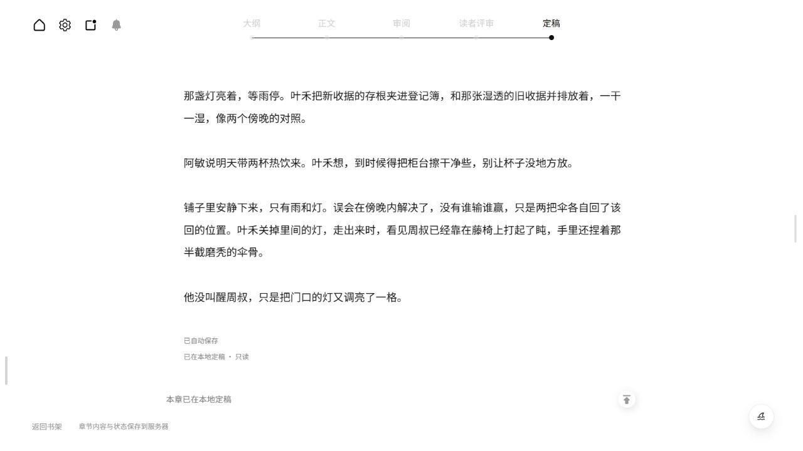

# GuraNovel

**从章节思路到本地定稿的 AI 小说创作工作台。**

[English](README.en.md) · [v0.12.0 试写版](https://github.com/WastonGura/GuraNovel/releases/tag/v0.12.0) · [GitHub Actions](https://github.com/WastonGura/GuraNovel/actions/workflows/ci.yml) · [GPLv3](LICENSE)

GuraNovel 面向个人小说作者，将大纲比较、正文编辑、反馈修订和多角色审阅放在同一个工作区。你决定采用哪个方案、如何修改以及何时定稿，AI 提供候选内容和审阅建议。

当前发布版本为 **v0.12.0 桌面个人试写版（Prerelease）**，适合在自己的电脑上体验完整章节流程。默认无需模型密钥即可试用；接入真实模型后可验证生成与修订效果。



*Studio 的本地定稿界面，正文来自真实模型试写样本。完整过程及质量限制见[桌面验收记录](docs/acceptance/v0.12.0-desktop.md)。*

[快速启动](#快速启动) · [第一次写作](#第一次写作) · [使用真实模型](#使用真实模型) · [当前限制与后续计划](#当前限制与后续计划) · [本地开发](#本地开发) · [文档导航](#文档导航)

## 已实现的能力

**创建作品 → 保存章节思路 → 三个大纲方案 → 比较、选择与编辑 → 确认大纲 → 正文生成与修订 → 审阅 → 可选读者评审 → 本地定稿**

| 环节 | 当前支持 |
| --- | --- |
| 作品与设定 | 书架、Studio、独立设定集；设定文档可编辑、软删除和恢复，保留文档身份与历史 |
| 思路与大纲 | 思路自动保存；每批生成三个方案，支持比较、选择、编辑和换一组，保留历史批次 |
| 正文与修订 | 根据确认的大纲生成正文；直接编辑、选文评论、提交修改要求，保留来源版本 |
| 内容审阅 | Editor、Chief Editor、Lore 分阶段审阅；可选 Reader 提供读者视角建议 |
| 保存与定稿 | 思路、评论和正文保存到服务端；冲突校验与本地恢复副本；定稿后正文只读 |

大纲确认绑定准确版本，正文生成后锁定大纲，后续改动通过正文修订完成。Reader 只提供诊断，不改写正文。**本地定稿保存在当前服务中，不会发布到外部平台。**

## 快速启动

推荐使用 **Docker Engine / Docker Desktop 与 Docker Compose**。Windows 请选择 Docker Desktop 的 Linux 容器；原生 Windows 不作为后端服务部署环境。

### 1. 获取并启动试写版

以下命令适合首次安装，固定使用已发布的 `v0.12.0`：

```bash
git clone --branch v0.12.0 --depth 1 https://github.com/WastonGura/GuraNovel.git
cd GuraNovel
git rev-parse HEAD
docker compose up -d --build --wait
docker compose ps
```

打开 **[写作工作台](http://127.0.0.1:5173)**，后端接口说明在 [API 文档](http://127.0.0.1:8000/docs)。首次构建需要下载镜像和依赖。

默认使用 **fake Provider（确定性示例）**，无需密钥，Reader 关闭。它用于体验保存和写作流程；实际 AI 创作需按[使用真实模型](#使用真实模型)配置。

> 已有数据的用户请先阅读 [v0.12.0 升级与备份说明](docs/releases/v0.12.0.md#从-v0110-升级)，保留原 Compose 项目名称、数据卷和私密配置。

### 2. 检查服务

```bash
curl --noproxy '*' -fsS http://127.0.0.1:8000/api/v1/health
curl --noproxy '*' -fsS http://127.0.0.1:5173/api/v1/health
```

PowerShell 使用 `curl.exe`。两个地址应返回健康状态，版本为 `0.12.0`。

### 3. 停止、查看日志与保留数据

```bash
docker compose logs --tail=100 backend frontend db
docker compose down
```

`docker compose down` 保留数据卷，下次在同一目录使用相同 Compose 项目启动即可继续。**`docker compose down -v` 会永久删除数据库和正文工作区，升级时不要使用。**数据库与工作区文件共同构成作品数据，必须配对备份和恢复。

## 第一次写作

1. 在书架创建作品，进入 Studio，新建章节；需要时先编辑设定集。
2. 输入章节思路，等待保存完成，再生成大纲方案。
3. 比较三个方案，选择一个继续编辑；“换一组”会保留之前的批次。
4. 确认大纲并生成正文。阅读正文，直接编辑、选文评论，或提交修改要求。
5. 提交审阅，阅读建议并处理需要修改的问题；真实模型配置下可选择读者评审，也可跳过。
6. 最后确认本地定稿，章节变为只读终稿。

生成或保存失败时，先检查页面保存提示与原任务状态，再使用对应的重试入口；响应超时不一定表示服务端没有执行。出现版本冲突时，保留本地文本并核对服务端内容后再继续。

## 使用真实模型

### 1. 准备配置

复制 `backend/.env.example` 为 `backend/.env`（Bash 用 `cp`，PowerShell 用 `Copy-Item`），填写服务商地址、密钥和模型：

```dotenv
CHAPTER_GENERATION_PROVIDER=openai_compatible
CHAPTER_PRODUCTION_PROVIDER=openai_compatible
READER_PANEL_PROVIDER=openai_compatible
OPENAI_COMPATIBLE_BASE_URL=https://your-provider.example/v1
OPENAI_COMPATIBLE_API_KEY=replace-with-your-private-key
OPENAI_COMPATIBLE_MODEL=your-supported-model
OPENAI_COMPATIBLE_TIMEOUT_SECONDS=120
```

`backend/.env` 已从 Git 和 Docker 构建上下文中排除，不要提交实际密钥。真实模型调用由你配置的服务商处理，所需正文与设定上下文会发送给该服务商，并可能产生费用。

### 2. 使用模型覆盖文件启动

普通 Compose 不会自动读取 `backend/.env`，需显式使用仓库提供的覆盖文件：

```bash
docker compose -f docker-compose.yml -f docker-compose.models.example.yml up -d --build --wait
```

该覆盖文件启用 `quick` Reader；不需要时将其中的 `READER_PANEL_MODE` 改为 `off`。容器数据库与工作区设置仍由基础 Compose 管理，不采用 `.env` 示例中的宿主机路径。之后查看状态、日志或停止服务时，也沿用相同的 `-f` 组合。

服务商支持时，可选设置 `OPENAI_COMPATIBLE_REASONING_EFFORT`，取值为 `none`、`low`、`medium`、`high` 或 `max`；省略则不发送该参数。实际抽测使用 `deepseek-flash`、`none` 与 120 秒超时，其他模型的兼容性、延迟和质量需要单独验证。

## 常见问题

| 现象 | 检查方式 |
| --- | --- |
| 无法连接 Docker | 启动 Docker Desktop，检查 Linux 容器与 WSL Integration；Linux 检查 Docker 服务 |
| 5173 或 8000 端口被占用 | 在根目录 `.env` 设置 `GURANOVEL_FRONTEND_PORT`、`GURANOVEL_BACKEND_PORT`，重新启动，并使用新端口访问和检查健康状态 |
| 配置密钥后仍返回示例 | 确认使用模型覆盖文件启动，且 `CHAPTER_GENERATION_PROVIDER`、`CHAPTER_PRODUCTION_PROVIDER` 已设为 `openai_compatible` |
| 生成超时或返回无效结果 | 先核对原任务和服务日志，再从页面重试，避免创建重复生成任务 |

根目录 `.env` 用于 Compose 端口等参数，`backend/.env` 用于模型与后端配置，两者用途不同。前后端默认仅绑定 `127.0.0.1`，PostgreSQL 不向宿主机开放端口。`GURANOVEL_BIND_ADDRESS=0.0.0.0` 会向其他主机开放应用端口；本试写版按本机使用验收。

## 当前限制与后续计划

模型可能漏改、漏检矛盾、超出字数目标、返回无效结构或英文评语。多角色审阅通过也不能保证内容正确，定稿前仍需作者判断。真实模型验收完成了两个试写样本，其中一个完成 Reader；流程通过与内容质量分开记录，详见[验收记录](docs/acceptance/v0.12.0-desktop.md)。

| 后续方向 | 跟踪入口 |
| --- | --- |
| 设定讨论、完整历史恢复 | [#301](https://github.com/WastonGura/GuraNovel/issues/301)、[#311](https://github.com/WastonGura/GuraNovel/issues/311) |
| 手机适配、作品元数据、分卷 | [#304](https://github.com/WastonGura/GuraNovel/issues/304)、[#307](https://github.com/WastonGura/GuraNovel/issues/307)、[#308](https://github.com/WastonGura/GuraNovel/issues/308) |
| 助手统一、导出 | [#310](https://github.com/WastonGura/GuraNovel/issues/310)、[#312](https://github.com/WastonGura/GuraNovel/issues/312) |
| 新构思与维护界面、旧任务续办、完整阶段验收 | [开发计划](docs/development-plan-2026-10.md)、[#313](https://github.com/WastonGura/GuraNovel/issues/313) |

正式界面只有一套：书架、Studio 和独立设定集。旧工作台链接兼容跳转，历史 V1 任务保持只读。尚未接入的界面能力会禁用或说明限制。多人协作、公开部署、外部发布和 EPUB 不属于本版。

## 本地开发

开发请使用完整仓库的 `main` 和独立 issue 分支；上面的浅克隆标签用于固定版本试用。技术栈为 **React / TypeScript / Vite + FastAPI / SQLAlchemy / PostgreSQL + 版本化文件工作区**。

后端使用 Linux/macOS/WSL、Python 3.11+、uv 和可访问的 PostgreSQL 16；前端使用 Node.js 20.19+ 或 22.12+ 与 npm（Docker/CI 使用 Node 22）。准备 `backend/.env`，设置本地 `DATABASE_URL` 与可写的 POSIX `WORKSPACE_BASE_DIR`。Compose 默认数据库没有宿主机端口，本地开发服务需要单独准备可访问的数据库。

在仓库根目录启动后端：

```bash
cd backend
uv sync --frozen --all-groups
uv run alembic upgrade head
uv run uvicorn app.main:app --reload --host 127.0.0.1 --port 8000
```

另一个终端从仓库根目录启动前端：

```bash
cd frontend
npm ci
npm run dev
```

前端默认代理到 `127.0.0.1:8000`。新行为遵循 **Red → Green → Refactor**；已有实现补充回归测试。本地运行改动对应的定向测试，Python 安装与运行统一使用 uv。

完整门禁由 **GitHub Actions** 执行：Ruff、架构/单元、真实 PostgreSQL 集成与迁移、前端 lint/单元/类型/构建/设计规范、Chromium、版本一致性和 Docker 作者流程。交付采用 **issue 分支 → PR → review → Squash merge**，不直接推送 `main`；规则见 [CONTRIBUTING.md](CONTRIBUTING.md)。

## 文档导航

| 文档 | 内容 |
| --- | --- |
| [发布说明与升级](docs/releases/v0.12.0.md) | v0.12.0 变化、迁移、配对备份与回退 |
| [桌面验收记录](docs/acceptance/v0.12.0-desktop.md) | Docker、交互验证、真实模型抽测与已知限制 |
| [前端入口说明](docs/frontend-interface.md) | 正式入口、旧链接兼容与能力边界 |
| [开发计划](docs/development-plan-2026-10.md) | 批次安排、后续范围与验收约定 |
| [开发日志](docs/development-log.md) | 按东京时区记录实现、合并、验证与发布 |
| [架构说明](docs/architecture.md) | 后端结构、数据与工作流设计 |
| [贡献指南](CONTRIBUTING.md) | 分支、提交、TDD、PR 与检查要求 |

GuraNovel 使用 [GNU GPL v3](LICENSE) 许可证。
