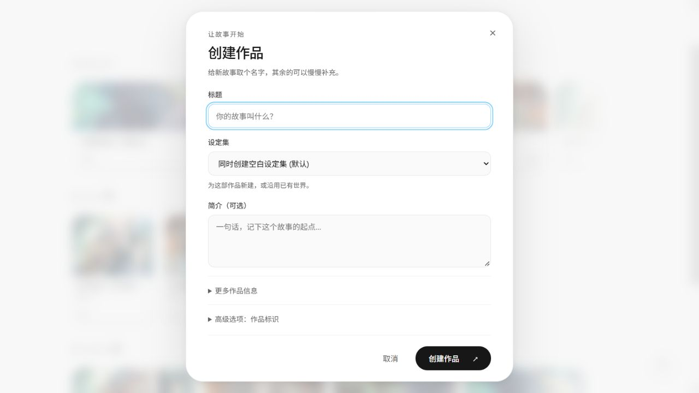
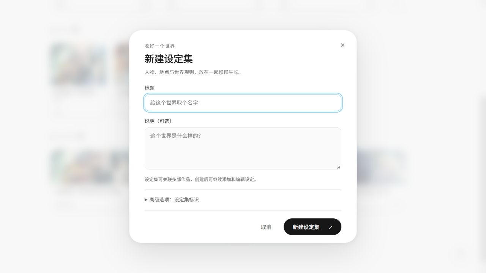
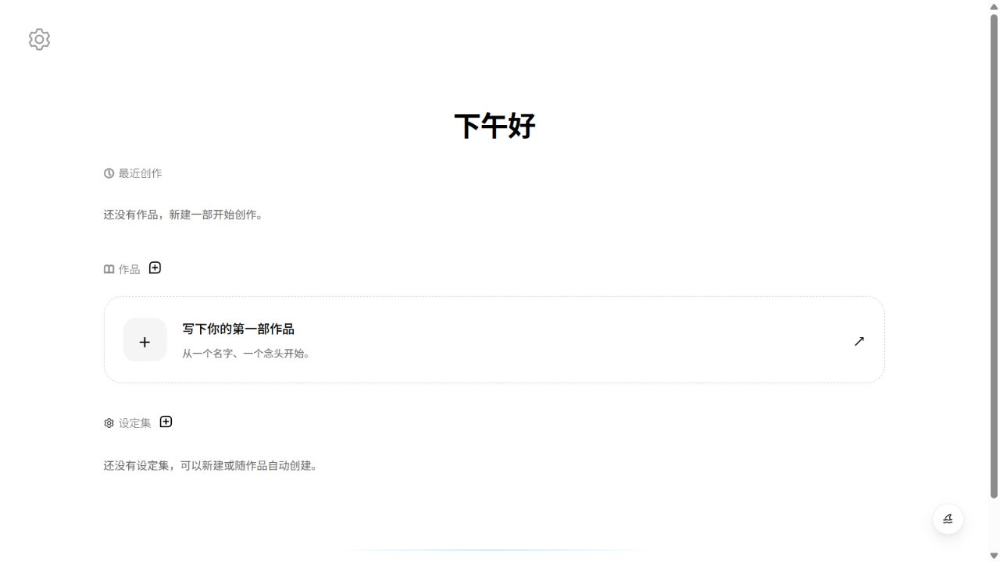

# 书架与创建弹窗验收（#351）

日期：2026-10-16，Asia/Tokyo。此为 v0.12.0 发布后的源码修复，应用版本和已发布标签不变。交付及最新 Actions 结果以 [PR #352](https://github.com/WastonGura/GuraNovel/pull/352) 为准。

## 改动与设计依据

用户截图暴露了创建弹窗与书架样式不一致、欢迎语过于靠上、空书架仍预留完整卡片行的问题。对照已有设计恢复白底、黑灰文字、居中欢迎语、约 1000px 内容列和光晕交互；新增设定集分区随内容排列，允许整页纵向滚动。原始私密设计文件未提交。

两个创建入口共用原生模态组件。作品默认只展示标题、设定集和简介，题材、平台、标签、封面与标识可展开填写；设定集的标识使用中文并折叠。保留现有请求字段、创建后导航与错误恢复。

## 测试证据

- Red：新增 3 个组件行为测试在修改前失败：空书架没有直接创建入口、设定集原生取消事件没有关闭/恢复焦点、提交中 Escape 导致弹窗消失。
- Red：Chromium 在 1440×1024 中测得旧欢迎语 y=40.95px，低于设计验收的 150–220px 范围。
- Green：Dashboard 全部 17 个组件测试通过，包括原有 14 个回归用例；3 个定向 Chromium 用例通过。
- 浏览器覆盖：1440×1024 与 1920×1080 的内容层级、1280×720 默认表单无需滚动、820×600 的长表单/分区滚动、390×600 的弹窗宽度与操作可达性、低频字段展开、焦点约束/恢复、提交期间 Escape/背景点击、失败保留及聚焦。
- 本地 lint 和类型/构建通过。构建仍提示既有入口包超过 500kB；本次没有引入新依赖或代码分割改动。完整适用门禁由 PR 的 GitHub Actions 执行。
- 本地 5173 已占用，Chromium 使用仓库外临时配置和 15385 端口，未停止已有服务。最初端口/配置错误，以及不完整 HTTP fixture 被客户端拒绝，不作为有效 Red。

## 视觉复核

以下为 1280×720 的浏览器截图。两个弹窗来自新前端连接既有 QA 后端；仅打开/取消表单，没有创建额外作品或调用模型。空书架使用构建产物与只返回空列表的 HTTP 测试替身，不能作为后端持久化验收。

## 本地部署更新

合并后，在干净 checkout 更新 main 并重新构建前端：`docker compose up -d --build --wait frontend`。沿用现有 Compose 项目名称、配置文件组合与数据卷；使用模型覆盖文件的部署继续携带相同 `-f` 参数。固定在 v0.12.0 标签的 checkout 不会自动获得此修复，标签不移动。原有未提交修改应先保留，避免直接覆盖。
